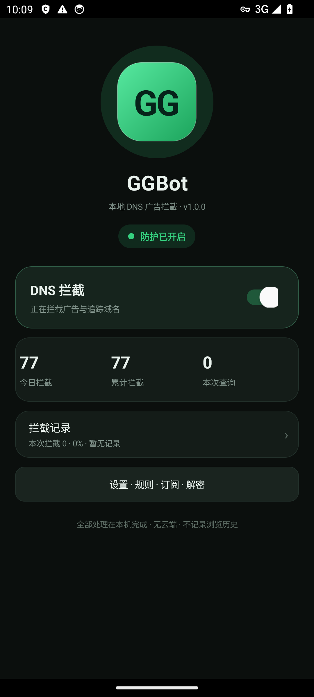

# GGBot

GGBot 是一款 Android 本机 VPN 型广告过滤应用：基于 `VpnService` 建立本地 TUN 隧道，
在用户态完成 **DNS 拦截 + TCP 转发 + HTTPS MITM 解密 + 规则引擎匹配**。



## 特性

- **VPN 型 DNS 拦截**：用户态解析/构造 DNS 报文，域名与 CNAME 链双重判定，带 TTL 缓存与并发查询合并
- **用户态 TCP 栈**：握手、序号/ACK、滑动窗口、半关闭、上传方向背压，全部自实现
- **HTTPS 解密（MITM）**：动态 CA 签发，证书钉扎（pinning）失败站点自动放行；支持内容改写
- **规则引擎**：兼容 Adblock 风格语法（`||`、`^`、通配符、修饰符、`badfilter`），支持订阅自动更新
- **DoH 加密上游**：RFC 8484，加密优先、明文回落（阿里/腾讯/Cloudflare/Google 四端点）
- **快速设置磁贴**、开机自启、tun 自愈守卫、Shizuku 无障碍写回（跳过类规则）
- **宝宝回家（公益）**：接民政部全国救助寻亲网公开数据，按省份筛选在站儿童，照片实时加载不本地缓存
- **赞赏码**随 APK 签名分发并做防拆包校验

## 系统要求

- Android 7.0+（minSdk 24，targetSdk 34）
- 过滤 HTTPS 需安装并信任应用内生成的 CA 证书（应用内有安装指引）

## 构建

macOS 或 Linux，需 JDK 21+ 与 Android SDK（platform-34、build-tools 34.0.0）。
`ANDROID_HOME` 已设置时自动使用，否则回退到脚本内默认路径（可自行修改脚本头部的 `SDK=`）。

```bash
# 一键回归：编译 src+test 并跑门闸（纯 JVM，无需真机，约 40 秒）
./test.sh

# 全量门闸（更多套件）后出包
./gate.sh && ./build.sh
```

产物为根目录 `GGBot.apk`，用 `adb install -r GGBot.apk` 安装。
签名密钥不随仓库分发：本地无 `ggbot.keystore` 时构建脚本会自动生成调试密钥；
正式发布请通过 `GGBOT_KS_PASS` 环境变量提供自己的口令与密钥。

## 项目结构

| 目录/文件 | 说明 |
|---|---|
| `src/com/ggbot/app/` | 全部应用源码（70 个 Java 文件，约 1.2 万行） |
| `src/moe/shizuku/api/` | Shizuku BinderContainer（自包含，45 行 Parcelable） |
| `test/` | 20 个纯 JVM 测试类（800+ 断言），`./test.sh` 或 `./gate.sh` 运行 |
| `assets/blocklist.txt` | 内置默认拦截规则 |
| `.github/workflows/ci.yml` | CI：macOS 上跑回归 + 出包 |

核心模块速览：

| 层 | 关键文件 | 职责 |
|---|---|---|
| 隧道主循环 | `DnsVpnService` | VpnService + TUN 读写、UDP DNS 收包/回包、分派 TCP |
| DNS | `DnsPacket` `DnsCache` `RealResolver` `Coalescer` `FakeIp` `DoH` | 报文解析构造、TTL 缓存、上游查询、并发合并、加密上游 |
| TCP | `TcpProxy` `TcpPacket` `Icmp` | 用户态 TCP 栈与 ICMP 回执 |
| MITM | `Mitm` `MitmBypass` `CaStore` `Der` `RespGate` | TLS 拦截、动态 CA、pinning 放行、响应门闸 |
| HTTP | `HttpGate` `UrlRule` `TokenIndex` `UrlIndex` `Rewrite` | 明文 HTTP 分帧、请求体状态机、URL 规则、内容改写 |
| 规则引擎 | `Rules` `RuleSet` `Decision` `ListParser` `Modifiers` `Domains` `Wild` | 规则匹配、adblock 列表解析、修饰符语义 |
| 订阅与配置 | `Feeds` `FeedJob` `Config` `Stats` `Diag` `Events` | 订阅下载、每日更新、配置持久化 |
| UI 与运维 | `MainActivity` `SettingsActivity` `Ui` `Notif` `GgTileService` `A11y*` `Shizuku*` `TunGuard` `Integrity` | 界面、通知、磁贴、无障碍跳过、自愈、完整性校验 |

## 贡献

欢迎 Issue 与 PR。提交前请跑 `./test.sh`，改动核心协议层（`TcpProxy`/`HttpGate`/`RespGate`）时
建议再跑 `./gate.sh`——这两套门闸覆盖了大量协议帧边界与静默失效场景，最容易抓到回归。

## 许可证

本项目基于 [Apache License 2.0](LICENSE) 开源。

内置规则数据与 `test/samples/` 下的样本来自公开的广告拦截社区列表（EasyList 系等），
其使用遵循各自原始发布渠道的惯例；如需商用分发请自行复核数据来源。

## 免责声明

本项目仅供学习与研究使用，请遵守所在地区的法律法规。因使用本软件产生的任何直接或间接
后果由使用者自行承担。
